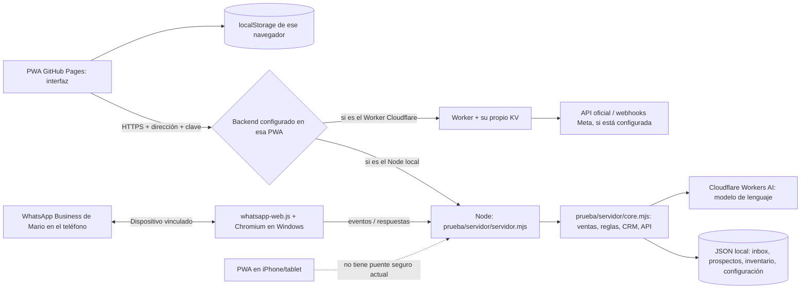

# Sofía: mapa real, conexiones y plan de unificación

**Revisado el 23 de noviembre de 2026.** Este documento es el estado práctico del proyecto para Isaac, Mario y cualquier IA que trabaje en Sofía. Lee primero `AGENTS.md` y `AI_CONTEXT.md`; después usa este archivo como mapa de arquitectura y decisiones. No contiene llaves, teléfonos ni mensajes de clientes.

## Resumen en una frase

Sofía no es una sola aplicación ni un solo servidor. Es una PWA para operar, un backend que guarda datos y aplica reglas, y un conector que mantiene la sesión de WhatsApp Web. Cloudflare Workers AI es solamente un proveedor de IA. Para ver los chats en el iPhone, la PWA tiene que llegar al mismo backend que recibe los mensajes; hoy el conector de Mario corre en Windows y escucha únicamente en `127.0.0.1`, así que la web pública no puede leer su bandeja.

## Qué está confirmado ahora

- La versión actual de la PWA está en `https://creoqisaac-cloud.github.io/Sofia/` y se publica desde GitHub Pages.
- Los cambios actuales de IA Cloudflare, etiquetas y fotos están publicados en la rama operativa de Pages; el ajuste de la prioridad de IA quedó en el commit `67afb09` (verificar el SHA actual con `git log`).
- El proceso de WhatsApp de Windows sigue ejecutándose con el supervisor `Sofia.ps1 -Mario`. El indicador local dice **Vinculado** y el servicio Node responde en una dirección de loopback `127.0.0.1` con puerto temporal.
- El perfil persistente de WhatsApp de Mario está bajo `%LOCALAPPDATA%\\SofiaWhatsAppMario\\datos\\sesion-mario`. **No borrarlo, moverlo ni reemplazarlo.** Reiniciar el conector normalmente reutiliza esa sesión.
- El almacén local del conector conserva registros de bandeja. La app que no apunta a ese servidor puede aparecer vacía aunque los mensajes sigan guardados.
- En esta revisión, el almacén del conector no muestra una configuración guardada de `conexion:meta` ni una configuración de ventas guardada. Eso no demuestra qué servidor está conectado en el navegador; sí significa que no se debe asumir que el Cloudflare ID/token o el interruptor «Con IA» que se tocaron en otro dispositivo llegaron a este proceso de Windows.
- El servicio local solo escucha en `127.0.0.1`; no está expuesto de forma segura al teléfono. No abrirlo a toda la red ni crear un túnel público sin autenticación.

## Diagrama de las piezas



**Regla clave:** que una pantalla diga “Servidor conectado” solo confirma que la PWA alcanzó *algún* backend con la dirección y clave configuradas. No confirma por sí sola que ese backend sea el Node que tiene la sesión de Mario. Tampoco confirma que la API de WhatsApp esté conectada. Son estados distintos:

| Estado | Qué significa | Qué no significa |
|---|---|---|
| Servidor conectado | La PWA puede llamar al backend indicado en Más → Conexiones → Servidor. | Que sea el backend de Windows o que contenga chats. |
| WhatsApp vinculado (Windows) | WhatsApp Web está autenticado en el perfil local. | Que el teléfono pueda alcanzar la bandeja local. |
| Cloudflare AI conectada | El backend al que apunta la app puede llamar al modelo de Cloudflare. | Que esté conectado WhatsApp o sincronizados los chats. |
| Con IA activa | La vendedora puede pedirle redacción al modelo. | Que cada respuesta sea inventada o que el modelo tenga acceso a datos de otro servidor. |

## Recorrido de un mensaje de cliente

### Con el WhatsApp actual de Mario (dispositivo vinculado)

1. El cliente escribe al WhatsApp Business de Mario.
2. La sesión de WhatsApp Web abierta por `whatsapp-web/cliente.mjs` recibe el evento.
3. El proceso llama a `eventoVinculado()` en `prueba/servidor/core.mjs`.
4. El backend local guarda mensaje e índice de conversación en `%LOCALAPPDATA%\\SofiaWhatsAppMario\\datos\\kv`.
5. Si la configuración de ventas está activa, el backend aplica primero frenos y reglas seguras; después puede usar IA si «Con IA» está activa y hay modelo configurado.
6. La respuesta sale por la misma sesión de WhatsApp Web y se guarda en la misma bandeja.

El proceso y la sesión están en Windows. Si la computadora se apaga, pierde internet o se cierra Sofía, este método deja de atender hasta volver a iniciar.

### Por qué no ves esos chats en Sofía Web

La PWA de GitHub Pages es una página estática. La bandeja no vive en GitHub Pages ni aparece por solo iniciar sesión. La PWA consulta `GET /api/buzon` al backend que tenga configurado en **Más → Conexiones → Servidor**.

El Node de Mario escucha ahora en `127.0.0.1` (loopback), una dirección que solo significa “esta misma computadora”. Un iPhone no puede usar el `localhost` de la PC: para el iPhone, `localhost` sería el propio iPhone. Además, si la PWA del teléfono apunta al Worker público, ese Worker tiene su propio KV y no puede leer los archivos locales ni la sesión Chromium de Windows. Por eso puedes haber conectado un backend o la IA y aun así ver la bandeja vacía.

En el escritorio, `WhatsApp → Bandeja → Traer pendientes de WhatsApp` pide al conector vinculado que importe mensajes recientes y luego los muestra. El botón no responde a clientes. El comando `/sofia pendientes` hace una importación parecida desde el chat propio de Mario. No reconstruye automáticamente todo el historial antiguo.

## Qué contiene Sofía

### 1. Interfaz web móvil (`prueba/`)

La aplicación activa es `prueba/index.html` y `prueba/js/`; no es `src/`. La PWA sirve para iPhone, Android, tablet y computadora. Conserva clientes, ajustes y preferencias locales en el almacenamiento de cada navegador. Por sí sola no ejecuta respuestas 24/7.

Pantallas principales:

- **Hoy:** trabajo y seguimientos del día.
- **Clientes:** CRM manual, ficha, etapa, bitácora, recordatorio, crédito y placas.
- **WhatsApp:** bandeja, conversación, respuestas, comandos, plantillas, prospectos y configuración de la vendedora.
- **Inventario:** autos, fotos y datos que debe usar la vendedora.
- **Más → Conexiones:** backend, credenciales de Meta, Cloudflare AI, Google y otros servicios.
- **Redes:** publicaciones y agenda social.
- **Mi estilo de venta:** ejemplos importados y preferencias para borradores.

Una PWA instalada en dos dispositivos tiene dos `localStorage` distintos. El respaldo por Google/servidor ayuda a compartir ciertos datos, pero no es una transmisión en vivo de la bandeja WhatsApp.

### 2. Cerebro y API (`prueba/servidor/core.mjs`)

Es la lógica común: reglas de ventas, respuestas, historial, inventario, prospectos, citas, CRM automático y endpoints como `/api/buzon`, `/api/prospectos`, `/api/agente/config`, `/api/conexion`, `/api/enviar` y `/api/ia/cloudflare/probar`.

Al recibir un primer mensaje, Sofía crea un **prospecto** con nombre disponible del perfil y número de WhatsApp. Eso se guarda en el backend como prospecto; no siempre se convierte inmediatamente en un cliente del CRM de la PWA. En **WhatsApp → Automático → Prospectos nuevos**, Mario puede tocar **Agregar como cliente**. Si el perfil no entrega nombre, se utiliza un nombre provisional a partir del número.

### 3. Servidor Node local (`prueba/servidor/servidor.mjs`)

Es el backend que está junto al conector de Windows. Guarda sus datos en archivos JSON dentro de `SofiaWhatsAppMario\\datos\\kv`, conserva versiones del respaldo principal y puede usar Workers AI por la API REST. Su dirección/puerto de loopback puede cambiar al reiniciar. Esta instancia es la que hoy está pegada al WhatsApp Web de Mario.

### 4. Conector WhatsApp Web (`whatsapp-web/`)

Usa Chromium y la librería `whatsapp-web.js` con una sesión persistente `LocalAuth`. Es una vía **no oficial** de automatización: no es la API Cloud oficial de Meta. Usa el mismo WhatsApp Business vinculado en el teléfono. No borrar el perfil ni volver a escanear QR mientras la sesión actual funcione.

Comandos actuales en el chat propio «Tú»:

- `/sofia ayuda`: lista comandos.
- `/sofia pendientes`: importa/lista chats recientes pendientes; no envía respuesta.
- `/sofia responder 1`: responde solo al primer pendiente de la lista vigente.
- `/sofia etiquetar no leídos`: agrega la etiqueta ya existente «Prospecto» a chats no leídos; no manda mensajes.

No hay difusión masiva ni respuesta masiva activa. Las etiquetas son etiquetas de WhatsApp Business y deben existir allí antes de aplicarlas. La web agregó etiqueta individual y envío de foto de inventario con vista previa y confirmación.

### 5. Worker Cloudflare (`prueba/servidor/cloudflare/`)

Es otra forma de alojar `core.mjs`; tiene su propio almacén KV y sus propios secretos/configuración. Puede recibir webhooks de Meta si se configura la API oficial. **No comparte automáticamente** los archivos JSON ni la sesión WhatsApp Web del Node local.

El Worker puede tener un binding `AI`, o el backend puede guardar un Account ID y un token de Workers AI para llamar por API REST. Esto se configura en **Más → Conexiones → IA gratis de Cloudflare** dentro del backend correspondiente. La interfaz no copia las credenciales entre dos backends.

### 6. Proveedor de IA

Hay dos usos diferentes:

- **IA de la interfaz**: borradores, personalización, lectura de documentos. El proveedor y la llave pueden guardarse en el navegador; esa función no pone la vendedora 24/7 a contestar.
- **IA de la vendedora**: corre dentro del backend y participa en respuestas automáticas. Requiere `ventas.ia = true` en **WhatsApp → Automático**, más Workers AI disponible o una llave Anthropic en ese mismo backend.

La prioridad actual del backend es Workers AI (para usar la cuota gratuita) y luego Claude si no hay Cloudflare configurado. Si falla el modelo, la lógica comercial responde con las reglas disponibles y deja el error registrado; no debe fabricar precios ni condiciones.

### 7. Google, placas y recordatorios

`prueba/js/google.js` y `prueba/servidor/google/sofia-google.gs` gestionan la conexión de Google Apps Script: respaldo de datos, agenda/calendario y el flujo de Gmail para placas/gestoría. Es un servicio distinto de WhatsApp y Cloudflare AI. Una conexión de Google no sincroniza conversaciones.

### 8. Otras generaciones y Bicky.AI

- `src/` contiene otra generación/prototipo y módulos fuente compartidos; editar una pantalla allí no actualiza la PWA operativa salvo que el build genere el artefacto correspondiente.
- Bicky.AI fue indicado como **referencia** para diseñar funciones. No hay evidencia en el repositorio de una integración de API, cuenta o datos con Bicky. No decir que Sofía está conectada a Bicky.

## Solución recomendada sin perder el vínculo

### Paso inmediato: no mover WhatsApp

Dejar abierta la sesión actual y conservar `%LOCALAPPDATA%\\SofiaWhatsAppMario\\datos\\sesion-mario`. No registrar el número por otra ruta de Meta, no borrar `datos`, no copiar una sesión activa a dos servidores a la vez.

### Corto plazo: hacer visible la bandeja en el teléfono

Primero hay que hacer que la PWA y WhatsApp apunten a **un mismo backend**. Hay dos rutas:

1. **Mantener Node en Windows** y montar un puente HTTPS autenticado (por ejemplo, túnel con nombre y restricción de acceso), con CORS limitado al dominio de Sofía. La sesión sigue en la PC y esta debe permanecer encendida. No exponer el puerto directamente ni quitar la clave.
2. **Migrar a un servidor persistente/VPS** con almacenamiento persistente. Copiar y validar los datos y la sesión requiere una ventana controlada; no arrancar dos sesiones del mismo número a la vez. Puede requerir volver a vincular, por eso primero se respalda y se ensaya. Un Worker de Cloudflare no mantiene Chromium ni una sesión LocalAuth persistente.

Para mantener el riesgo bajo, mi recomendación es primero crear una pantalla «Estado de Sofía» que muestre claramente: servidor seleccionado, si es local o remoto, WhatsApp vinculado y modo (WhatsApp Web/Meta API), base de datos origen, IA disponible y botón **Abrir bandeja**. Después crear y probar el puente seguro hacia el backend local; conservar el backend como fuente única mientras se valida. Solo entonces valorar migración.

### Largo plazo: decidir si conservar WhatsApp Web o usar Meta

| Ruta | Ventajas | Costos/condiciones |
|---|---|---|
| WhatsApp Web vinculado (actual) | Conserva el uso del teléfono y evita rehacer ahora el alta de Meta. | No oficial, puede desconectarse; requiere PC/servidor activo y almacenamiento Chromium persistente. |
| API oficial de Meta / coexistencia | Webhooks y operación de servidor más apropiados para servicio continuo. | Alta, permisos, revisión y configuración de Meta; no asumir que ya está conectada. Validar coexistencia antes de tocar el número. |

No cambiar de ruta por confusión de interfaz. Primero demostrar recepción, respuesta, bandeja y persistencia en la ruta actual.

## Orden de trabajo sugerido

1. **Diagnóstico de conexiones (solo lectura):** obtener desde la PWA URL del servidor (sin imprimir la clave), estado de `GET /api/estado`, modo WhatsApp, timestamp, `publicUrl`, número redactado y base de datos seleccionada; comparar con el estado de Windows y su almacenamiento.
2. **Resolver la bandeja vacía:** verificar si PWA apunta a `sofia-conector.workers.dev` mientras WhatsApp está en `127.0.0.1`; importar un chat permitido desde el conector local y confirmar que `/api/buzon` lo lista en el mismo backend.
3. **Unificar fuentes:** escoger un backend canónico. La PWA, WhatsApp entrante, prospectos, inventario y configuración del agente deben usar el mismo endpoint y almacenamiento.
4. **Estado visual simple:** estados separados para backend, WhatsApp, IA y sincronización; errores en lenguaje de usuario; botones «Probar conexión» y «Actualizar bandeja» con hora de la última sincronización.
5. **CRM y ventas:** nombres/números, historial, interés, cotizaciones basadas solo en las corridas cargadas, citas, siguiente paso, etiquetas reales de WhatsApp y seguimiento revisable.
6. **Automatización controlada:** la IA redacta dentro de límites, usa datos de inventario/configuración, registra errores, pausa para Mario cuando atiende y requiere confirmación para difusiones/acciones masivas.
7. **Prueba gradual:** teléfono de prueba autorizado, luego uno o dos clientes con permiso, después operación normal. Nunca probar envío masivo con clientes reales.

## Guía rápida: dónde está cada dato

| Dato | Fuente de verdad actual | Se ve desde el iPhone ahora |
|---|---|---|
| Sesión WhatsApp Web | Carpeta LocalAuth de Windows | No |
| Mensajes del conector | `inbox:index` y `inbox:<canal>:<id>` del backend donde llegaron | Solo si la PWA consulta ese backend; el Node actual está limitado a Windows |
| Prospectos automáticos | `leads:index` del mismo backend que recibió mensajes | Igual que la bandeja |
| Clientes/actividad manual | `state.customers` y `state.activity` en localStorage de la PWA, opcionalmente respaldo Google/servidor | En ese dispositivo, salvo sincronización/respaldo configurado |
| Inventario y fotos | La PWA y `ventas:inventario`/`media:<id>` del backend | No asumir que son iguales si se usan dos backends |
| Credenciales de Workers AI | Configuración del backend al que estaba conectada la PWA al guardarlas, o secretos del Worker | No se comparten automáticamente |
| Corridas y ajustes de la vendedora | `agente:config` del backend | La PWA solo ve lo del servidor al que apunta |

## Prompt para continuar con Claude u otra IA

```text
Lee primero AGENTS.md, AI_CONTEXT.md y SOFIA_MAPA_Y_PLAN.md. Antes de editar, identifica qué backend está usando la PWA y cuál tiene la sesión de WhatsApp de Mario. El WhatsApp Web actual está vinculado en Windows: conserva el perfil %LOCALAPPDATA%\\SofiaWhatsAppMario\\datos\\sesion-mario. No pidas escanear QR ni migres el número a Meta sin un plan aprobado. El problema actual es que la PWA no muestra la bandeja; primero diagnostica la diferencia entre el backend local (localhost/127.0.0.1 con JSON local) y cualquier Worker Cloudflare (KV independiente). Propón y construye una conexión móvil HTTPS autenticada, con CORS restringido, sin exponer claves, solo después de documentar el backend canónico. Mantén visibles y separados los estados Servidor, WhatsApp y Cloudflare AI. No copies mensajes, teléfonos ni secretos a Git/logs. No respondas ni difundas mensajes reales durante pruebas. Al terminar, explica qué backend es fuente de verdad, cómo se actualizan la PWA y el conector, y cómo volver atrás sin perder sesión ni datos.
```

## Archivos que Claude debe abrir primero

- `AI_CONTEXT.md` — reglas compartidas de trabajo.
- `AGENTS.md` — instrucciones del repositorio.
- `prueba/js/v-connections.js` — conexión del navegador a backend y a Workers AI.
- `prueba/js/connector.js` — llamadas API desde la interfaz.
- `prueba/js/v-whatsapp.js` — bandeja, chats, prospectos y comandos web.
- `prueba/servidor/core.mjs` — persistencia, API, ventas, IA y mensajes.
- `prueba/servidor/servidor.mjs` — Node local y almacenamiento JSON.
- `prueba/servidor/cloudflare/worker.mjs` — backend Worker y KV independiente.
- `whatsapp-web/cliente.mjs` y `whatsapp-web/windows/Sofia.ps1` — sesión actual y arranque seguro.
